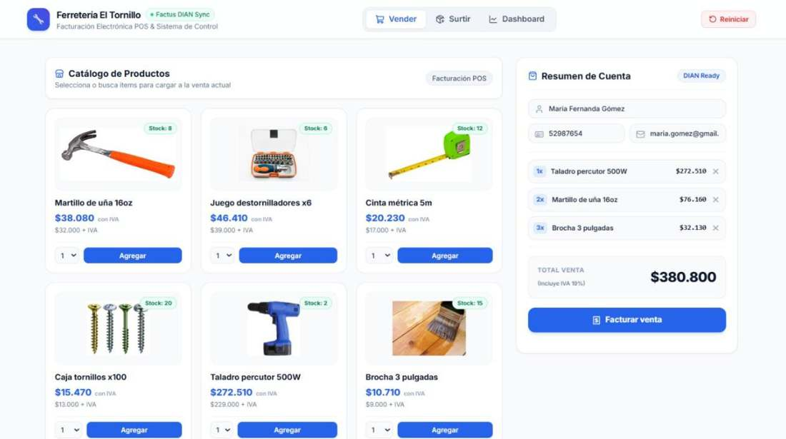
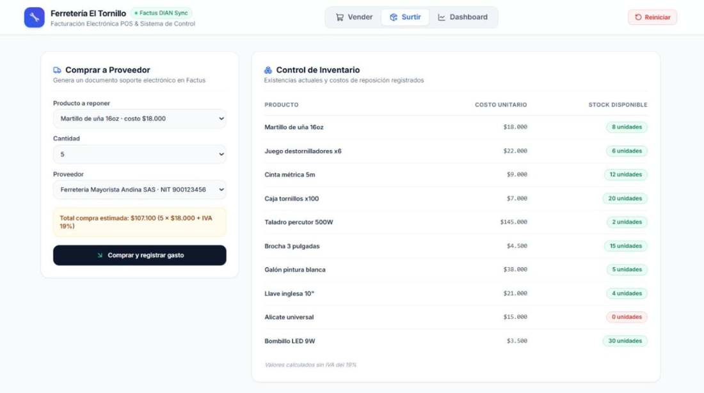
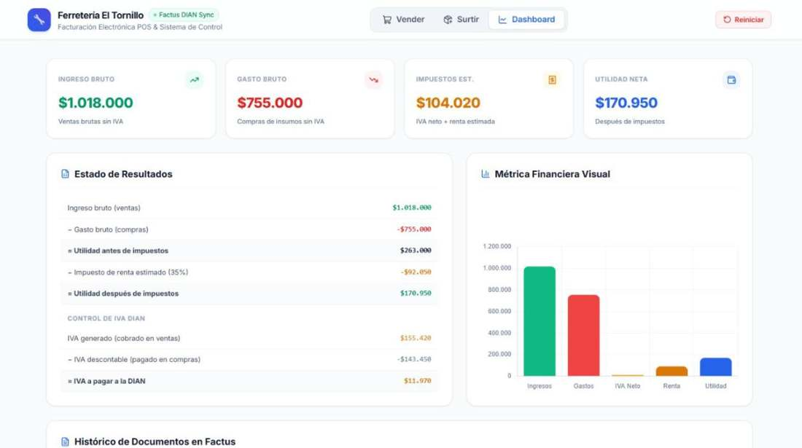

# 🔧 Ferretería El Tornillo · POS con Facturación Electrónica

Punto de venta para una ferretería que **factura electrónicamente ante la DIAN**, **cobra con QR** y muestra en un **dashboard financiero** cuánto se vende, cuánto se gasta, cuánto se paga en impuestos y cuánto queda de utilidad. Todo se alimenta de los documentos reales emitidos en **Factus**.

Proyecto construido para la hackathon de **Factus** (API de facturación electrónica de Colombia).



---

## ✨ Qué hace

| Módulo | Qué pasa | Documento en Factus |
|---|---|---|
| 📦 **Surtir** (gastos) | Compras inventario a un proveedor; sube el stock | **Documento soporte** (`/v2/support-documents/validate`) |
| 🛒 **Vender** (ingresos) | El cliente escribe nombre y cédula, arma un carrito con varios productos y se emite **una sola factura**; baja el stock | **Factura electrónica de venta** (`/v2/bills/validate`) + **cobro QR** en Factus Pay |
| 📊 **Dashboard** | Consulta cada documento en Factus y calcula el estado de resultados | Lectura de `/v2/bills/{n}` y `/v2/support-documents/{n}` |
| 📄 **PDF** | Abre la representación gráfica oficial de cada factura o documento soporte | `/v2/.../{n}/download-pdf` |

<table>
<tr><td><b>📦 Surtir</b><br></td><td><b>📊 Dashboard</b><br></td></tr>
</table>

### Dashboard financiero
- **Ingreso bruto** (ventas sin IVA) y **gasto bruto** (compras sin IVA)
- **Utilidad antes de impuestos**
- **IVA** desglosado: IVA generado − IVA descontable = **IVA a pagar a la DIAN**
- **Impuesto de renta estimado** (35 %, configurable con `TASA_RENTA`)
- **Utilidad después de impuestos**

---

## 🏗️ Arquitectura

```
Navegador (index.html: Tailwind + Chart.js)
        │  fetch /api/...
        ▼
Flask (app.py) ──► Factus API v2 (OAuth2)  → facturas, documentos soporte, PDFs, rangos de numeración
        │      └─► Factus Pay API          → cobros (recaudos) con QR
        ▼
tienda.json  (inventario + números de documentos emitidos por esta tienda)
```

- El backend pide un **token OAuth2 nuevo en cada operación**, así nunca se vence durante la demo.
- Las credenciales nunca llegan al navegador: el frontend solo habla con Flask.
- La cuenta sandbox de Factus es compartida, por eso la app guarda los números de **sus propios** documentos y el dashboard consulta solo esos.
- El rango de numeración (factura de venta / documento soporte) se elige automáticamente.
- El dígito de verificación (DV) del NIT de los proveedores se calcula con el algoritmo de la DIAN.

---

## 🚀 Correr en local

Requisitos: Python 3.10+

```bash
git clone https://github.com/<tu-usuario>/ferreteria-el-tornillo.git
cd ferreteria-el-tornillo
pip install -r requirements.txt
cp .env.example .env        # en Windows: copy .env.example .env
# edita .env con tus credenciales de Factus y Factus Pay
python app.py
```

Abre http://localhost:5000

### Variables de entorno

| Variable | Descripción |
|---|---|
| `FACTUS_URL` | URL de la API (sandbox: `https://api-sandbox.factus.com.co`) |
| `FACTUS_CLIENT_ID` / `FACTUS_CLIENT_SECRET` | Credenciales OAuth2 de Factus |
| `FACTUS_USERNAME` / `FACTUS_PASSWORD` | Usuario de Factus |
| `FACTUS_PAY_EMAIL` / `FACTUS_PAY_PASSWORD` | Usuario de Factus Pay (opcional: sin esto no se generan cobros QR) |
| `TASA_RENTA` | Tarifa de renta para el estimado (por defecto `0.35`) |

---

## ☁️ Desplegar en Render (gratis)

1. Sube este repositorio a GitHub.
2. Entra a [render.com](https://render.com) e inicia sesión con GitHub.
3. **New → Blueprint** y elige este repositorio (Render lee `render.yaml`).
   *(Alternativa: **New → Web Service**, Build `pip install -r requirements.txt`, Start `gunicorn app:app --workers 1 --timeout 120`)*
4. Llena las variables de entorno que te pide (las mismas del `.env`).
5. **Deploy**. En unos minutos tendrás una URL tipo `https://ferreteria-el-tornillo.onrender.com`.

> **Nota:** en el plan gratuito el servicio se duerme tras 15 min sin uso (la primera visita tarda ~1 min) y el disco no es permanente: el inventario (`tienda.json`) se reinicia cuando el servicio se reinicia. Las facturas siguen existiendo en Factus.

---

## 🔌 Endpoints del backend

| Método | Ruta | Uso |
|---|---|---|
| GET | `/` | Interfaz |
| GET | `/api/productos` | Inventario |
| POST | `/api/comprar` | Compra a proveedor → documento soporte |
| POST | `/api/vender` | Venta con carrito → factura + cobro QR |
| GET | `/api/dashboard` | Indicadores financieros desde Factus |
| GET | `/pdf/<venta|compra>/<número>` | PDF oficial del documento |
| POST | `/api/reiniciar` | Deja la tienda en cero (para demos) |

---

## 🧰 Tecnologías
Python · Flask · Requests · Tailwind CSS · Chart.js · Lucide Icons · Factus API v2 · Factus Pay

Imágenes de productos: Wikimedia Commons (licencias libres).

## 🩺 Problemas comunes

| Mensaje | Qué pasa | Solución |
|---|---|---|
| *Se encontró una factura pendiente por enviar a la DIAN* | Factus no deja facturar si quedó una factura sin validar | La app elimina las pendientes (`DELETE /v2/bills/destroy/reference/{ref}`) y reintenta sola |
| *El campo id rango de numeración es inválido* | Se usó un rango que no es de factura de venta | La app elige el rango activo automáticamente |
| *Version de API no disponible para esta empresa* | Se llamó a `/v1/` en una cuenta v2 | Usar los endpoints `/v2/` |

## ⚠️ Limitaciones conocidas
- Es un prototipo de hackathon que corre en el **sandbox** de Factus.
- La renta es una estimación simple (35 % sobre la utilidad) y no incluye retenciones.
- Todas las compras se toman como gasto del periodo (no costo de ventas).

## 📄 Licencia
MIT · Hecho por Juan Pablo Moreno Cadena
